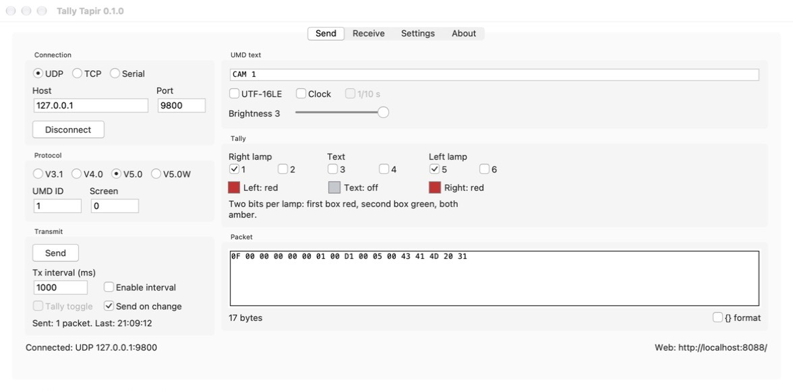
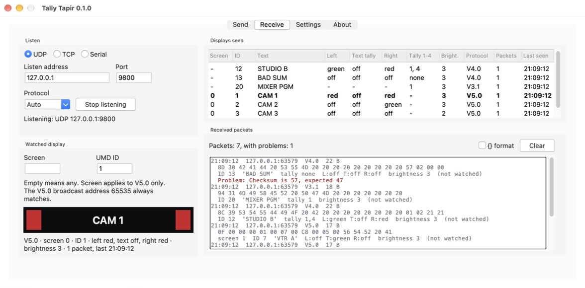
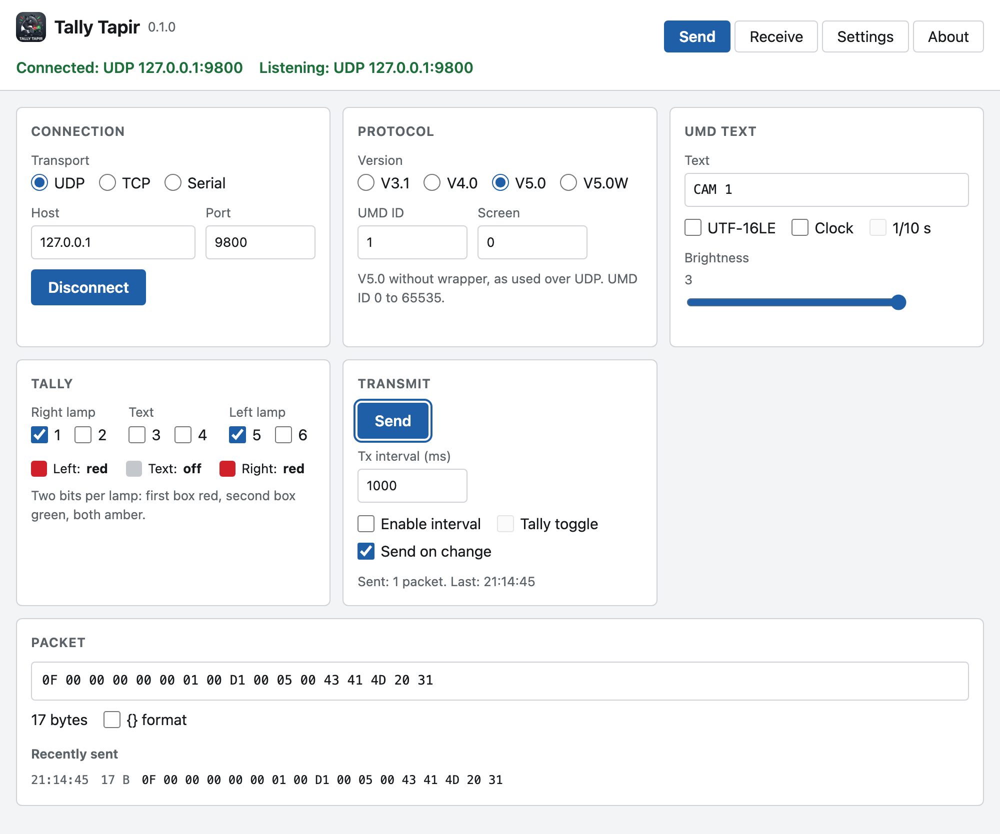
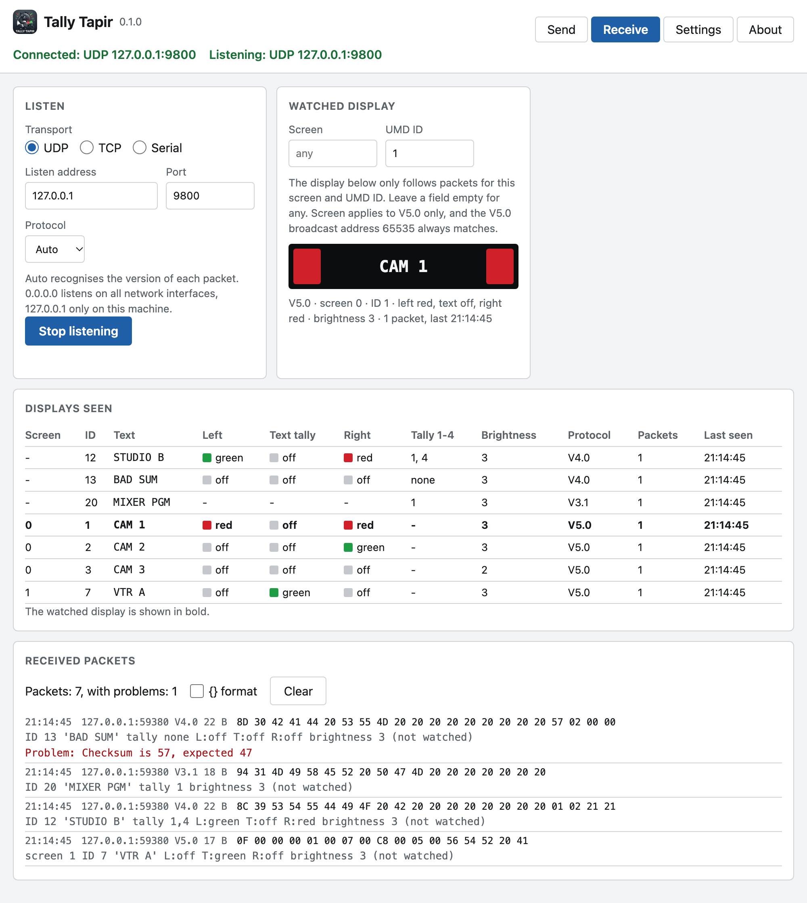

<p align="center">
  
</p>

# Tally Tapir

Tally Tapir sends and receives TSL UMD packets, the protocol that switches
tally lamps and writes text under monitors in broadcast. It is a test tool:
set a tally and see whether your multiviewer lights up, or listen and see what
your mixer really sends.

It speaks TSL V3.1, V4.0 and V5.0 over UDP, TCP and serial lines, and runs on
macOS, Windows and Linux.



## What it does

- **Send:** UMD text, three lamps in red, green and amber, brightness, any UMD
  ID and screen. Once, on every change, or on a timer, with a blinking tally
  or the time of day as text if you like.
- **Receive:** lists every packet as hex and decoded, marks what is wrong with
  it (checksum, byte count, length), keeps a table of all displays seen, and
  shows one display of your choice like a real UMD.
- **Four ways to use it,** all on the same sender and receiver: a desktop
  window, a web interface, a [REST API](docs/rest-api.md) for other programs,
  and the Python library [tallytapir](https://github.com/MarcusMa-dotcom/tally-tapir-lib)
  to build TSL into your own software.
- **Access control:** web interface and REST API can be switched off
  separately, each with its own optional login. Passwords are stored as a
  salted hash.

## Get it

### Mac app

Download `Tally-Tapir-macOS.zip` from the
[latest release](https://github.com/MarcusMa-dotcom/tally-tapir/releases/latest),
unpack it and open `Tally Tapir.app`. It carries Python and everything else
it needs. It runs on Macs with Apple silicon, macOS 11 or newer.

The app is not signed with an Apple Developer ID. macOS therefore refuses the
first start. Allow it once under System Settings, Privacy & Security, "Open
Anyway".

### From source

Python 3.10 or newer, and git.

```bash
git clone https://github.com/MarcusMa-dotcom/tally-tapir.git
```

```bash
cd tally-tapir
```

```bash
python -m venv .venv
```

```bash
.venv/bin/pip install -r requirements.txt
```

```bash
.venv/bin/python -m tallytapir_app
```

On Windows use `.venv\Scripts\pip` and `.venv\Scripts\python`.

The desktop window needs Tk. It comes with the Python installers from
python.org. Elsewhere install it separately: `python3-tk` on Debian and Ubuntu,
`python-tk` with Homebrew. Without Tk the program runs without window.

## First steps

Starting the program opens the window and serves the web interface on
<http://localhost:8088/>.

To try it without any hardware:

1. Open **Receive** and press **Listen** (UDP, port 9800).
2. Open **Send** and press **Connect** (UDP, 127.0.0.1, port 9800).
3. Change the text or tick a tally box. The watched display in **Receive**
   follows.



The web interface shows the same views in the browser, also on a phone or
tablet:

| Send | Receive |
|---|---|
|  |  |

## Documentation

| Document | Content |
|---|---|
| [docs/usage.md](docs/usage.md) | Every control in Send, Receive and Settings, the start options, where settings are stored |
| [docs/rest-api.md](docs/rest-api.md) | The REST API: endpoints, fields, errors, recipes |
| [docs/security-audit.md](docs/security-audit.md) | What was checked, what was fixed, which risks remain |
| [docs/architecture.md](docs/architecture.md) | How the code is built, for people who want to change it |
| [examples/](examples/) | Scripts that control Tally Tapir through the REST API |

## REST API in two commands

Set display 3 to "CAM 3" with both lamps red, then connect, which sends it:

```bash
curl -X PATCH http://localhost:8088/api/v1/sender -H 'Content-Type: application/json' -d '{"host": "192.168.1.50", "port": 9800, "umd_id": 3, "text": "CAM 3", "tally_bits": 17}'
```

```bash
curl -X POST http://localhost:8088/api/v1/sender/connect -H 'Content-Type: application/json' -d '{}'
```

The same from Python, with the client class from
[examples/api_client.py](examples/api_client.py):

```python
from api_client import TallyTapirApi, lamp_bits

api = TallyTapirApi("http://localhost:8088")
api.set_sender(host="192.168.1.50", port=9800, umd_id=3, text="CAM 3",
               tally_bits=lamp_bits(left="red", right="red"))
api.connect()
```

Everything else is in [docs/rest-api.md](docs/rest-api.md).

## The library

If you want TSL in your own Python program without running Tally Tapir, use
the library it is built on:

```python
from tallytapir import Sender, Tally

with Sender.udp("192.168.1.50", 9800) as sender:
    sender.send(3, "CAM 3", left=Tally.RED, right=Tally.RED)
```

It lives in its own repository:
[tally-tapir-lib](https://github.com/MarcusMa-dotcom/tally-tapir-lib).

## Security in short

- By default the web server answers on the local machine only and needs no
  login.
- With `--host 0.0.0.0` it can be reached from the network. Then require
  logins and use HTTPS (`--tls-cert`, `--tls-key`): without HTTPS, passwords
  cross the network unencrypted. The program warns in the terminal and in
  Settings.
- Whoever may use the web interface or the API can make the machine send TSL
  packets to any address. Give access only to people who should have it.
- TSL has no login and no encryption. The receiver shows whatever arrives.

Details, findings and remaining risks: [docs/security-audit.md](docs/security-audit.md).

## Build the Mac app

`packaging/` holds the recipe for `Tally Tapir.app`:

```bash
.venv/bin/pip install pyinstaller .
```

```bash
.venv/bin/pyinstaller --noconfirm packaging/tally_tapir.spec
```

The app appears in `dist/`. It runs on the processor type of the Python it was
built with, from the macOS version that Python targets. The released app was
built with CPython 3.13.18 from python-build-standalone.

## Tests

```bash
.venv/bin/pip install pytest
```

```bash
.venv/bin/python -m pytest
```

The tests send real packets over UDP and TCP on the local machine and, on
macOS and Linux, over a pseudo terminal in place of a serial port.

## Not covered

- V5.0 control data and screen control data are reported, not decoded.
- The sender of the app handles one display at a time. The library can send
  several.
- Serial was tested over a pseudo terminal, not yet with real RS-422 hardware.
- Windows and Linux have not been run yet.

## License

MIT License. Copyright (c) 2026 Marcus Mathy. Use at your own risk: the
software comes as is, without warranty of any kind. The full text is in
[LICENSE](LICENSE).
