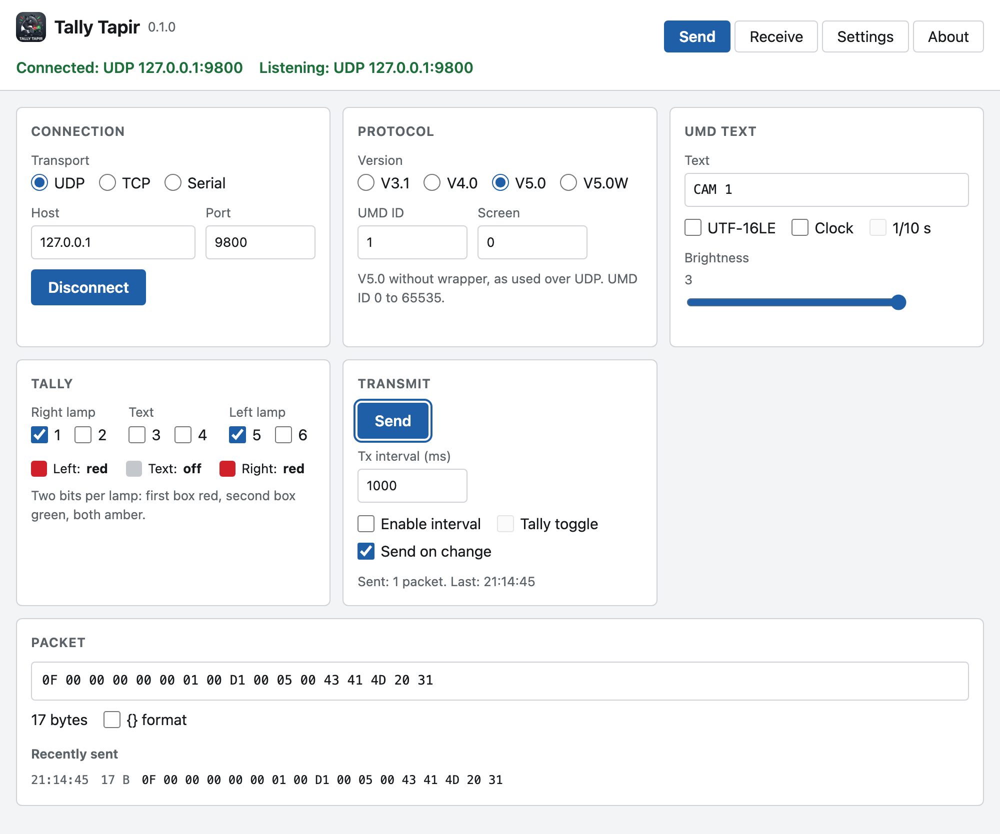
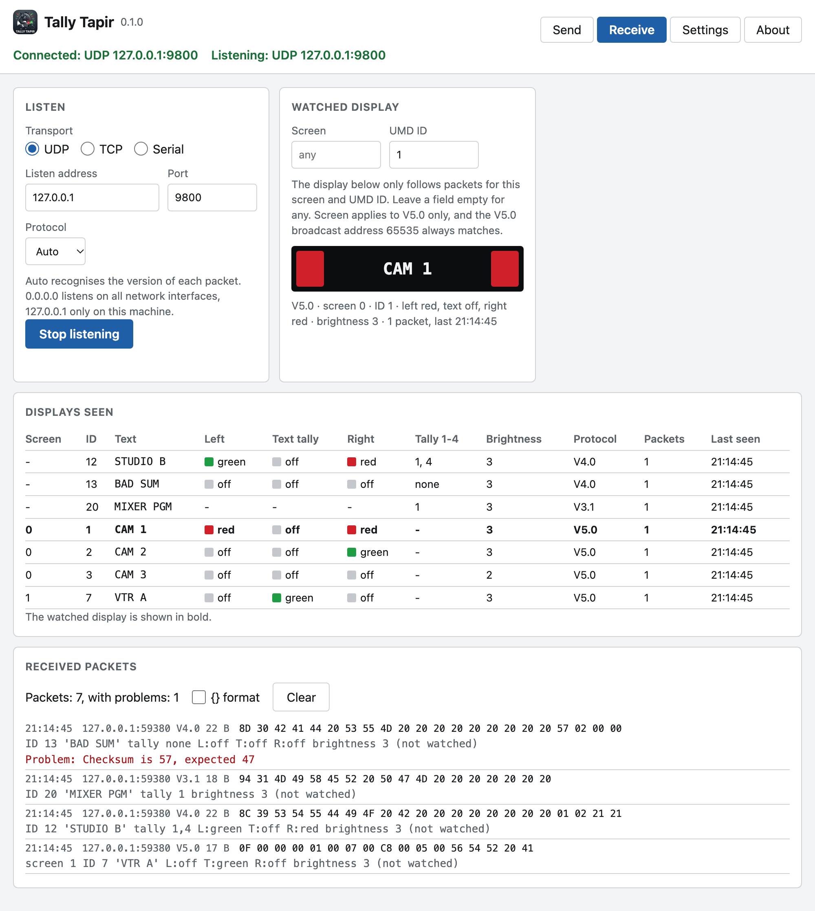
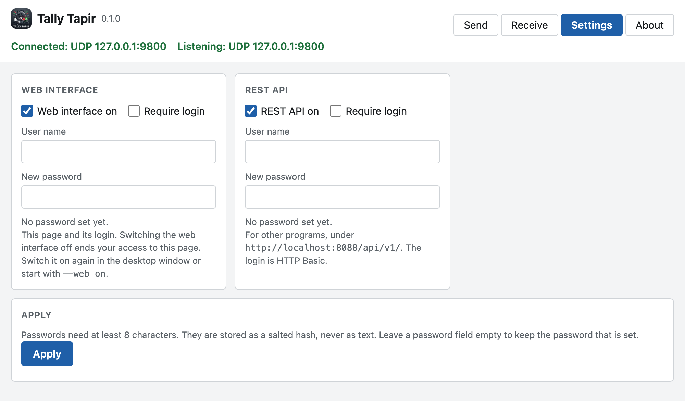

# Using Tally Tapir

The desktop window and the web interface show the same four views and control
the same sender and receiver. What you change in one appears in the other.

- [Starting](#starting)
- [Send](#send)
- [Receive](#receive)
- [Settings](#settings)
- [Where settings are stored](#where-settings-are-stored)

## Starting

```bash
python -m tallytapir_app
```

This opens the window and serves the web interface on <http://localhost:8088/>
and the REST API on <http://localhost:8088/api/v1/>. The packaged Mac app does
the same when opened.

| Option | Effect |
|---|---|
| `--no-gui` | No window, for a machine without a screen |
| `--no-web` | No web server: neither web interface nor REST API |
| `--port 8088` | Port of the web server |
| `--host 0.0.0.0` | Make the web server reachable from other machines |
| `--tls-cert FILE --tls-key FILE` | Serve over HTTPS |
| `--config FILE` | Settings file to use |
| `--web on` / `--web off` | Switch the web interface on or off |
| `--api on` / `--api off` | Switch the REST API on or off |
| `--web-login USER` / `--no-web-login` | Require a login for the web interface, or not |
| `--api-login USER` / `--no-api-login` | Require a login for the REST API, or not |

The four access options are saved, like changes in the Settings tab. A login
option asks for the password in the terminal. Without a terminal it reads the
password from `TALLY_TAPIR_WEB_PASSWORD` or `TALLY_TAPIR_API_PASSWORD`.
Passwords are never taken from the command line.

## Send



| Control | Meaning |
|---|---|
| Transport | UDP, TCP (as client) or serial. Serial defaults to 38400 baud, 8 data bits, even parity, 1 stop bit |
| Protocol | V3.1, V4.0, V5.0, or V5.0W (V5.0 with the DLE/STX wrapper used over TCP) |
| UMD ID | Display address: 0 to 126 for V3.1 and V4.0, 0 to 65535 for V5.0 |
| Screen | V5.0 only, 0 to 65535 |
| UMD text | V3.1 and V4.0 send the first 16 characters. V5.0 sends up to 256 |
| UTF-16LE | V5.0 only: send the text as UTF-16LE instead of single bytes |
| Clock, 1/10 s | Send the time of day as text, `hh:mm:ss` or `hh:mm:ss.t` |
| Brightness | 0 to 3 |
| Tally boxes 1 to 6 | Two bits per lamp: boxes 1 and 2 right lamp, 3 and 4 text, 5 and 6 left lamp. First box red, second green, both amber |
| Send | Send the current packet once |
| Tx interval | Send again every n milliseconds |
| Tally toggle | Switch the set tallies off and on with every interval |
| Send on change | Send as soon as a value changes, and once on connect |
| {} format | Show hex bytes as `{AA}{BB}` instead of `AA BB` |

The **Packet** box always shows the bytes the current settings produce, also
without a connection.

In V3.1, boxes 1, 2, 5 and 6 set tally 1 to 4. Boxes 3 and 4 have no effect
there. V4.0 sends both: the four tallies in the control byte and the three
lamps in XDATA.

Text that is not UTF-16LE goes out as Latin-1, so umlauts keep one byte each.

## Receive



Choose transport, address and port, then **Listen**. For TCP the receiver is
the server and accepts up to 32 senders. `0.0.0.0` listens on all network
interfaces, `127.0.0.1` only on this machine.

- **Received packets** lists everything that arrives: time, sender, protocol,
  hex bytes and the decoded content.
- **Problems** are marked on the packet: wrong V4.0 checksum, V5.0 byte count
  that does not match, wrong packet length, missing DLE stuffing, reserved bits
  that are set, bytes that do not start a packet.
- **Displays seen** has one row per screen and UMD ID with the latest state.
- **Watched display** shows text and lamps like a UMD, but only for packets
  that match the filter. Set **Screen** and **UMD ID**, or leave a field empty
  for any. The screen filter applies to V5.0 only. The V5.0 broadcast address
  65535 always matches.

**Protocol: Auto** recognises the version of each packet. On UDP that is
reliable. On TCP and serial the receiver has to cut the byte stream into
packets itself: a stream of unwrapped V5.0 packets whose first byte is 0x80 or
higher (text of about 118 bytes and more) is taken for V3.1. Select the
protocol by hand in that case.

### Try it without hardware

Open **Receive** and press **Listen** (UDP, port 9800). Open **Send**, press
**Connect** (UDP, 127.0.0.1, port 9800) and change text or tallies. The
watched display follows.

## Settings



The Settings view has two doors:

| Door | Switch | Login |
|---|---|---|
| Web interface | on or off | optional: user name and password, with a login page |
| REST API | on or off | optional: user name and password, as HTTP Basic |

The two logins are independent. With both doors off the port is closed.
Passwords need at least 8 characters and are stored only as a salted scrypt
hash.

If the web interface is switched off from the web interface, that page stops
working. Switch it on again in the window or start with `--web on`.

Changing the web login from the web interface needs the current password.
Without a web login, only the machine Tally Tapir runs on can change the
access settings.

When the web server is reachable from the network, the Settings view warns
about doors without login and about logins without HTTPS.

## Where settings are stored

| System | Folder |
|---|---|
| macOS | `~/Library/Application Support/tally-tapir/` |
| Windows | `%APPDATA%\tally-tapir\` |
| Linux | `~/.config/tally-tapir/` |

| File | Content |
|---|---|
| `settings.json` | Sender |
| `settings.receiver.json` | Receiver |
| `settings.access.json` | Switches, user names and password hashes. Readable by the owner only |

Settings are saved when they change and loaded at the next start. Delete the
folder to start from the defaults.
